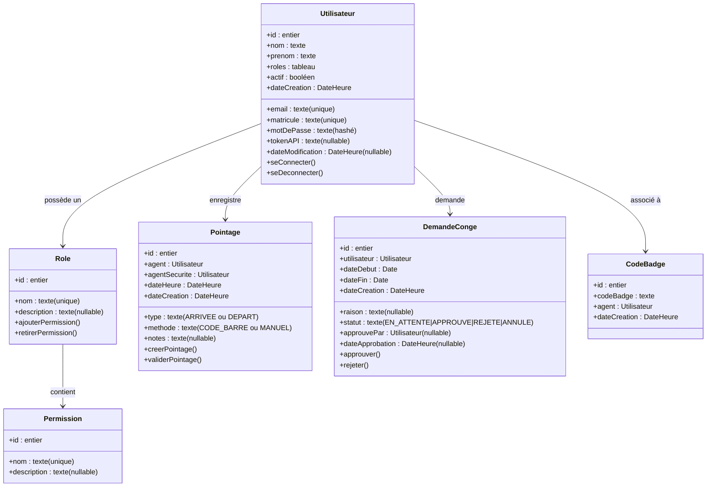

# UML du projet de système de pointage

Pour la soutenance, le modèle UML le plus simple à maîtriser est le diagramme de cas d’utilisation. Il permet de montrer clairement les fonctionnalités du système et les interactions entre les acteurs et le logiciel.

## 1. Choix du modèle UML

Je recommande de présenter :
- Diagramme de cas d’utilisation : pour la soutenance et la compréhension du projet.
- Diagramme de classes : si vous voulez compléter avec la structure technique du système.

## 2. Diagramme de cas d’utilisation

```mermaid
flowchart TD
    A[Agent] --> U1[Se connecter]
    A --> U4[Demander un congé]
    A --> U5[Consulter son historique]

    B[Agent de sécurité] -->
    U1[Se connecter]
     U2[Scanner le badge de l'agent]
    B --> U3[Enregistrer un pointage manuel]

    C[Responsable RH] --> 
     U1[Se connecter]
     C --> U9[gerer les pointages enregistres]
    U10[Valider les demandes de congé]
    U11[faire des rapports et exporter]
    C --> U7[Consulter les statistiques de présence]

    D[Administrateur] --> 
     U1[Se connecter]
    U8[Gérer les utilisateurs]
    C --> U9[gerer les pointages enregistres]
    U10[Valider les demandes de congé]
    D --> U12[Gérer les rôles et permissions]
    U11[faire des rapports et exporter]
    D --> U13[Administrer le système]
     C --> U7[Consulter les statistiques de présence]
    

    S[Système de Pointage] --> U1
    S --> U2
    S --> U3
    S --> U4
    S --> U5
    S --> U6
    S --> U7
    S --> U8
    S --> U9
    S --> U10
    S --> U11
    S --> U12
    S --> U13
```

## 3. Explication simple du diagramme

- L’agent peut se connecter, consulter son historique et demander un congé.
- L’agent de sécurité scanne le badge de l’agent et enregistre le pointage, y compris en mode manuel si nécessaire.
- Le responsable RH valide les demandes de congé et consulte les statistiques de présence.
- L’administrateur gère les utilisateurs, les rôles, les permissions et l’ensemble du système.
- Les statistiques de présence sont consultées par le RH et l’administrateur.

## 4. Diagramme de classes (optionnel)

## 5. Version courte à dire en soutenance

« Notre système de pointage permet à l'agent de sécurité de scanner le badge d'un agent et d'enregistrer son pointage (arrivée ou départ), y compris manuellement en cas d'incident. L'agent peut consulter son historique de pointages et demander un congé. Le responsable RH valide les demandes de congé et consulte les statistiques de présence. L'administrateur a accès à toutes les fonctionnalités du système : gérer les utilisateurs, les rôles, les permissions, gérer les pointages et les congés, ainsi que les rapports et statistiques. »
